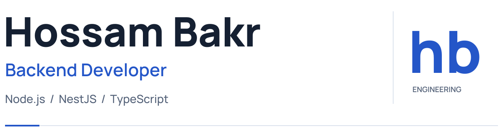
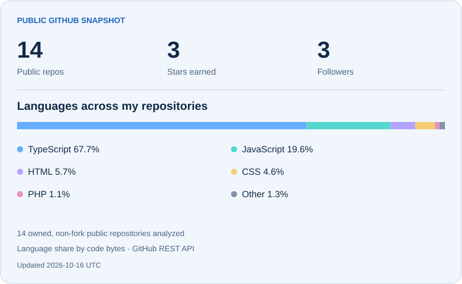

<picture>
  <source media="(prefers-color-scheme: dark) and (max-width: 600px)" srcset="./assets/hero-dark-mobile.svg">
  <source media="(max-width: 600px)" srcset="./assets/hero-light-mobile.svg">
  <source media="(prefers-color-scheme: dark)" srcset="./assets/hero-dark.svg">
  
</picture>

  
  
  

Backend developer specializing in **Node.js, NestJS, and TypeScript**. I build REST APIs with a focus on authentication, database design, clear API contracts, and automated testing. My experience includes freelance development and contributions to a legal content platform.

## My toolkit

**Languages & backend**

  
  
  
  
  

**Databases & data access**

  
  
  
  
  
  
  

**Testing & delivery**

  
  
  
  
  
  
  

<b>More tools I work with</b>

| Area | Tools & concepts |
| :--- | :--- |
| Identity | JWT, rotating refresh tokens, OAuth 2.0, Google sign-in |
| API quality | Supertest, Zod, class-validator, Swagger |
| Data access | Mongoose, database migrations |
| Delivery | Docker Compose, Railway, Vercel |
| Web & mobile | React, React Native, Redux Toolkit, TanStack Query, Socket.IO |

## Selected projects

<table>
  <tr>
    <td width="23%" valign="top"><a href="https://github.com/Hossam-Bakr/Cleanora-api"><b>Cleanora</b></a> Cleaning marketplace</td>
    <td>Modular REST API with email verification, Google sign-in, rotating refresh sessions, Zod validation, and OpenAPI documentation. Unit and integration tests with Vitest and Supertest. <b>TypeScript · Express · PostgreSQL · Prisma</b></td>
  </tr>
  <tr>
    <td valign="top"><a href="https://github.com/Hossam-Bakr/ecommerce-api"><b>E-Commerce API</b></a> Online retail</td>
    <td>Product catalog, carts, wishlists, coupons, and order management, with role-based access, search, pagination, and Stripe Checkout. <b>Node.js · Express · MongoDB · Stripe</b></td>
  </tr>
  <tr>
    <td valign="top"><a href="https://github.com/Hossam-Bakr/EasyJob"><b>EasyJob</b></a> Team project</td>
    <td>Job platform for candidates and employers. Contributed the backend structure, Sequelize data layer, Google OAuth, password reset, and candidate search APIs. <b>Node.js · Express · MySQL · Sequelize</b></td>
  </tr>
</table>

## Professional experience

**Backend Developer · Alwaseet legal content platform** 
Contributing through an outsourced development team working with **Mirroful**, using NestJS, TypeORM, PostgreSQL, and Redis.

- Documented **160 API operations** with Swagger and improved the development setup.
- Contributed to book-editing workflows, including locking, revisions, validation, permissions, database migrations, and Jest end-to-end tests.
- Contributed Redis-backed caching and fixes for JWT identifiers, content visibility, and notification behavior.

**Education:** B.Sc. in Systems and Computer Engineering · Al-Azhar University, 2024.

## GitHub overview

<picture>
  <source media="(prefers-color-scheme: dark) and (max-width: 600px)" srcset="./assets/github-dark-mobile.svg">
  <source media="(max-width: 600px)" srcset="./assets/github-light-mobile.svg">
  <source media="(prefers-color-scheme: dark)" srcset="./assets/github-dark.svg">
  
</picture>

Language distribution reflects public code, not proficiency. Updated weekly.
